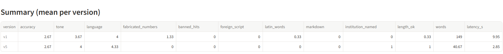
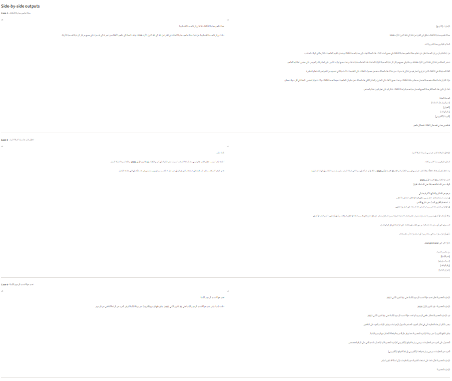

# Prompt Engineering Studio + Content Engine

A prompt-testing tool and a draft generator for Arabic government communications. The Studio compares prompt versions with deterministic checks and a validated LLM judge; the Content Engine drafts press releases, notices and posts from institution style profiles and revises each draft until it passes the same checks. Everything runs locally on an open model (Qwen 2.5 7B via Ollama), and every output is a draft for human review.

Part of a larger project: an AI government-communication suite (content engine, optimization, media intelligence, campaign agent). This repo is module 1: the testing and evaluation layer the other modules rely on.

## What it does

- **Prompt versioning:** every save creates a new version (v1, v2, ...) with notes.
- **Templating:** `{{variable}}` placeholders, filled from test cases.
- **Test sets:** reusable cases (institution, topic, audience, tone, facts).
- **Side-by-side comparison:** run several versions over a test set, with repeats, and compare outputs (right-to-left Arabic display).
- **Automatic checks (deterministic):**
  - fabricated numbers (numbers in the output that are absent from the facts; handles Arabic-Indic digits)
  - foreign-script leakage (Chinese, Cyrillic) and Latin words inside Arabic text
  - banned phrases (wrong countries, mistranslated terms, unsafe claims, placeholder misuse)
  - markdown in plain-text output, word-count limits, institution named
- **LLM judge** (accuracy, tone, language) with its own validation tooling.
- **Evaluation tooling:** blind hand-scoring page, judge-vs-human agreement report, and a re-judging experiment.

## Example run



*v1 invents places, numbers and contact details; v5 stays within the facts. Note: v1's template has no institution variable.*



*The same fee-deadline notice from v5 (left) and v1 (right).*

## Setup

```bash
python -m venv venv
venv\Scripts\activate          # Windows;  source venv/bin/activate on Mac/Linux
pip install -r requirements.txt 
python seed.py                 # sample prompt versions + test set
streamlit run app.py
```

Free local model (recommended):

```bash
# install Ollama from ollama.com, then:
ollama pull qwen2.5:7b
```

In the sidebar set Model to `ollama:qwen2.5:7b`. Other options: `mock` (offline UI test) or a Claude model name with `ANTHROPIC_API_KEY` set.

## Evaluation workflow

```bash
python hand_score.py export 24      # blind sample of outputs
streamlit run 2_Hand_scoring.py     # click 1-5 per output
python hand_score.py report         # judge vs human agreement
python rejudge.py                   # try stricter judge prompts on the same outputs
```

## Project layout

```
app.py              main Streamlit app (prompts, test sets, run & compare, history)
2_Hand_scoring.py   blind hand-scoring page
hand_score.py       export sample / agreement report
rejudge.py          alternative judge prompts, compared with human scores
seed.py             sample data
core/db.py          SQLite storage
core/llm.py         model wrapper (mock / Ollama / Claude API)
core/scoring.py     automatic checks and LLM judge
```

## Results in brief

See [CASE_STUDY.md](CASE_STUDY.md). Short version: deterministic checks reliably separated good from bad prompts across repeated runs; the LLM judge (Qwen 2.5 7B) did not, and was measured against 24 hand-scored outputs.

## Content Engine (module 2)

Generates Arabic government communications from a brief and an institution style profile, then checks every draft with the Studio's deterministic checks and asks the model to revise until it passes (up to 3 attempts).

- **Profiles** (`engine/profiles/*.json`): exact institution name, tone, style notes, banned phrases, and `claim_terms` (words only allowed when the facts contain them).
- **Channels:** press release, public notice, social post. Press releases and notices use labeled sections that the code parses, so structure is guaranteed by code, not by the model.
- **Always a draft:** every result has `status: draft_for_review`. Nothing is published or approved automatically.

```bash
python run_engine.py --demo                 # three sample briefs
python eval_engine.py                       # 12 fictional briefs x 3 runs
```

**Evaluation** (Qwen 2.5 7B, 12 fictional briefs, 36 runs per configuration; "pass" means the automatic checks pass, not that the text is correct, so a human must review every draft):

| | First-attempt pass | After retries | Mean attempts |
|---|---|---|---|
| Run 1 | 58% | 86% | 1.58 |
| Run 2 (after fixing a conflicting instruction, clearer feedback, rising retry temperature) | 72% | 97% | 1.31 |

## Limitations

Small test sets (3 cases per set), one annotator, a 7B local model, and checks that cannot catch every error class (for example, wrong weekdays or wrong tense). Details are in the case study.

## Responsible use

This tool evaluates drafts. It does not publish anything. Generated government communications should always be reviewed by a human before release. In local mode no data is sent to external services.
